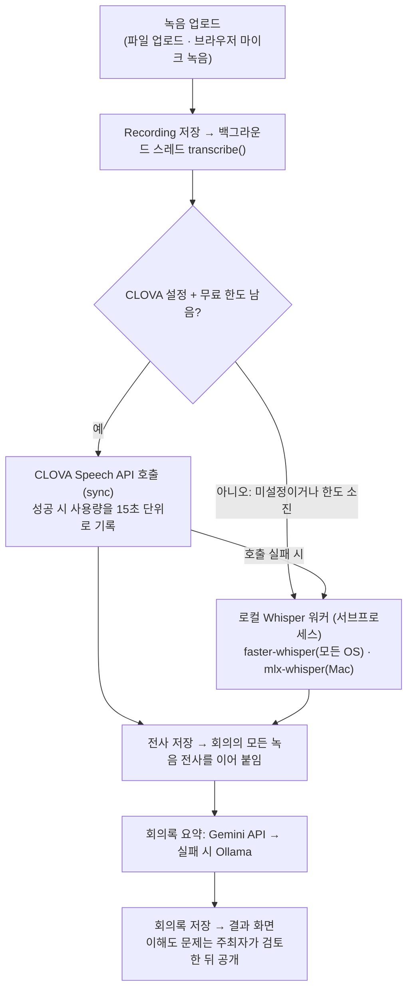

# MeetAlign 소프트웨어 사양서 (간략판)

2026-10-24 기준 · 작성: cocoa030722 · 원본(편집·댓글): https://claude.ai/artifact/2cvBg31S8WuaRMDceXPAd3

## 개요

MeetAlign(합의착시탐지기)은 회의 녹음 하나로 회의록을 만들고, 팀원들이 서로 다르게 이해한 지점을 짚어 주는 웹 서비스다. 대상은 주최자 1명과 팀원 여럿으로 이루어진 소규모 프로젝트 팀이다.

해결하려는 문제는 '합의 착시'다. 회의가 끝나면 모두 같은 결론에 동의했다고 믿지만, 기한·범위·담당자를 사람마다 다르게 기억하는 일이 잦다. MeetAlign은 전사 원문에서 모호한 표현을 찾아 객관식 확인 문제를 내고, 정답과 다른 보기를 고른 팀원을 근거 문장과 함께 보여준다.

현재 버전은 Django 단일 앱이다. 전사는 네이버 CLOVA Speech 또는 로컬 Whisper가, 회의록 요약과 문제 생성은 Gemini API 또는 로컬 Ollama가 맡는다.

## 주요 기능

핵심 흐름은 녹음 → 전사 → 회의록 → 확인 문제 → 불일치 표시의 다섯 단계다.

1. 녹음 업로드: 파일 업로드 또는 브라우저 마이크 녹음(MediaRecorder). 16개 형식(mp3, m4a, wav, webm 등), 500MB 이하, 회의당 여러 개.
2. 전사(STT): 업로드 즉시 백그라운드 스레드에서 처리하고 결과 화면이 5초마다 새로고침된다. 녹음이 여러 개면 파일명 구획으로 이어 붙인다.
3. 회의록 요약: [요약] [결정된 사항] [아직 논의 중인 사항] [할 일] [숫자와 기한] [모호한 표현] 6개 섹션. record.txt로 내려받을 수 있다.
4. 이해도 확인 문제: 전사 원문에서 모호한 표현을 찾아 4지선다 문제를 최대 5개 만든다(근거 문장 포함, 원문에 없는 근거는 폐기). 주최자가 검토·수정한 뒤 공개하며, 녹음이 추가되면 새로 늘어난 부분만으로 추가 문제를 제안한다.
5. 불일치 탐지: 정답과 다른 보기를 고른 팀원을 질문별로 표시하고 근거 문장을 함께 보여준다.

부가 기능: 6자리 팀 초대 코드, 회의 마감일과 D-1 배너, 익명 질문(질문한 본인만 답변 열람), 회의록 기반 대화창(최근 3턴 기억), 확인 퀴즈 미완료 인원 배지, 회의 종료, 팀·회의 삭제, 다크 모드.

## 시스템 구성

Django 앱 하나(`meetalign`)가 화면·모델·백그라운드 처리·외부 연동을 모두 맡고, 데이터는 SQLite와 media/ 폴더에 둔다. 전사와 요약은 환경변수에 따라 외부 API와 로컬 모델 사이를 자동으로 오간다.

CLOVA가 설정돼 있고 이번 달 무료 사용량이 남아 있을 때만 외부 API를 부르고, 그 외에는 모두 로컬 Whisper 경로를 탄다. 어느 엔진도 없으면 전사는 비어 있고 요약·문제 생성도 고정 응답으로 대체된다(가짜 응답 모드).

## 외부 연동과 실행 환경

서버는 Python 3.12 이상(검증은 3.14) + Django 6.1 + SQLite로 Windows·macOS·Linux에서 같게 동작하며, 전사·요약 엔진은 환경변수로만 바뀐다. 아무것도 설정하지 않으면 가짜 응답 모드로 화면 흐름만 확인할 수 있다.

| 역할 | 1순위 | 2순위로 넘어가는 조건 | 2순위 |
|---|---|---|---|
| 전사(STT) | 네이버 CLOVA Speech (`CLOVA_SPEECH_INVOKE_URL`, `CLOVA_SPEECH_SECRET_KEY`) | 이번 달 무료 사용량(`CLOVA_SPEECH_FREE_MINUTES`, 기본 20분) 소진, 또는 호출 실패(키 오류·네트워크·서버 오류) | 로컬 Whisper: `FASTER_WHISPER_MODEL`(모든 OS, NVIDIA GPU 자동 사용) 또는 `MLX_WHISPER_MODEL`(Apple Silicon) |
| 요약·문제 생성·대화 | Google Gemini API (`GEMINI_API_KEY`, `GEMINI_MODEL`) | 429/500/503을 3회 재시도 후에도 실패, 타임아웃(기본 300초), 키 오류, 빈 응답 | 로컬 Ollama (`OLLAMA_MODEL`, 컨텍스트 16384) |

무료 사용량 정책: CLOVA를 호출할 때마다 음성 길이를 15초 단위로 올림해 `SttUsage` 테이블에 기록하고, 매월 1일 0시에 집계를 새로 시작한다. 지금까지 사용량에 이번 녹음 길이를 더해 한도를 넘길 것으로 보이면 호출하지 않고 바로 로컬로 보낸다. 회의 상세 화면에 "이번 달 무료 사용량 n/20분"이 표시된다.

## 데이터와 프라이버시

모든 데이터는 로컬 SQLite(db.sqlite3)와 media/ 폴더에 남는다: 사용자 계정, 팀과 초대 코드, 회의(제목·마감일·주최자·전사 원문·회의록), 녹음 파일, 전사 상태와 오류 메시지, 이해도 문제와 답변, 익명 질문(작성자는 내부 저장, 화면에는 비노출), 사용자별 대화 기록, CLOVA 사용량.

외부로 나가는 데이터: CLOVA를 설정하면 녹음 파일이 네이버 클라우드로, Gemini를 설정하면 전사본·회의록·질문이 Google로 전송된다. 로컬 Whisper와 Ollama만 쓰면 아무것도 외부로 나가지 않는다. 무료 Gemini 키는 입력이 서비스 개선에 쓰일 수 있어, 민감한 회의는 로컬 구성을 권장한다.

권한 모델:

- 모든 화면은 로그인 필수. 팀 멤버만 그 팀의 회의에 접근한다.
- 녹음 파일은 /media/ 공개 경로 없이 회의 멤버에게만 뷰를 통해 전달한다.
- 주최자 전용: 문제 검토·공개·추가 생성, 익명 질문 전체 열람과 답변, 미완료 참가자 명단, 회의 삭제. 팀 삭제는 팀 생성자만.
- 팀 홈 배지는 미완료 인원 수만 보여주고 이름은 주최자 화면에서만 조회한다.

## 검증 현황

자동 테스트 181개가 전부 통과한다(`python manage.py test`, 약 2분). 테스트는 실제 모델이나 API를 부르지 않으며, 셸에 실행용 키가 있어도 시작 시 치워 두어 결과가 같다.

실측(2026-10-24, Windows 11 노트북, RTX 4060 Laptop, Python 3.14):

- CLOVA Speech(Free 도메인, 실제 키): 24초 한국어 음성을 2.5초에 전사, 사용량 30초 기록. 합성음 테스트에서 사람 이름 하나가 통째로 빠지는 현상을 관찰했다(같은 음성을 Whisper는 정확히 전사).
- faster-whisper large-v3-turbo(GPU, float16): 같은 음성을 모델 로딩 포함 7초에 전사. base 모델은 CPU int8로 4초.
- Gemini 무료 등급: 짧은 요청도 1~4분 걸리는 경우가 있어 타임아웃 300초와 일시 오류 재시도를 적용했다.
- 이전 단계(mlx-whisper + Ollama)에서 실제 50분 수업 녹음과 28분 회의 녹음으로 전사→요약→문제→대화→불일치 전체 파이프라인을 검증한 이력이 있다.

## 제약 사항과 향후 과제

현재 한계:

- 백그라운드 전사가 개발 서버의 스레드에 묶여 있어(작업 큐 없음) 서버가 재시작되면 진행 중이던 녹음은 "실패"로 복구되고 다시 시도 버튼으로 재처리해야 한다. 단일 프로세스와 SQLite를 전제한다.
- 프로젝트가 .env를 자동으로 읽지 않아 서버 실행 전에 환경변수를 직접 불러와야 한다.
- CLOVA 사용량 장부는 이 앱이 보낸 호출만 세며, 길이를 미리 알 수 없는 파일은 마지막 한 건이 한도를 넘길 수 있다. Free 플랜의 정확한 무료량과 초과 시 동작은 공식 문서에 수치가 없다.
- faster-whisper 1.2.1은 PyAV 19와 호환되지 않아 `av<19` 고정이 필요하다.
- 검증 결과 화면(verification)은 팀원 누구나 다른 팀원의 이름과 고른 보기를 볼 수 있어, 주최자 화면의 "이름은 완료 여부에만 연결한다" 기준과 어긋난다. 팀 결정이 필요하다.
- 마이크 녹음은 브라우저 정책상 localhost 또는 https에서만 동작한다.

향후 과제: 실제 회의 녹음으로 CLOVA 고유명사(이름) 인식 확인, 추적되지 않는 빈 디렉터리(meetalign/services/, static/vendor/) 정리, 배포 설정(DJANGO_DEBUG=0, DJANGO_SECRET_KEY) 점검.
