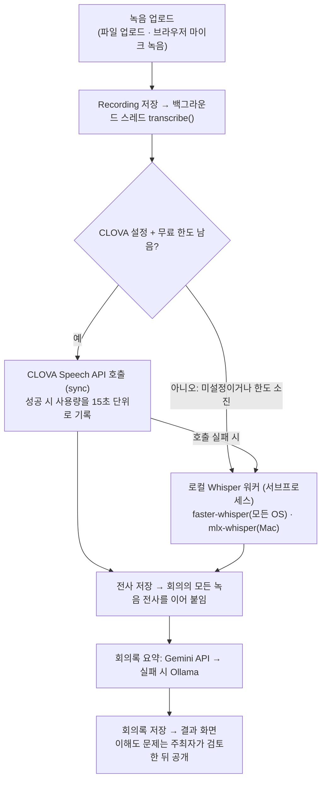

# MeetAlign 소프트웨어 사양서 (상세판)

2026-10-24 기준 · 작성: cocoa030722 · 원본(편집·댓글): https://claude.ai/artifact/7HuGnht61gxmRqnPp5sVhr

## 1. 문서 개요

이 사양서는 2026-10-24 기준으로 `main`에 머지된 내용과 `feature/clova-stt` 브랜치(커밋 c2b934f)까지 실제로 구현된 MeetAlign의 동작을 기술한다. 설계 문서의 계획이 아니라 코드와 테스트가 보증하는 범위만 다루며, 구현되지 않은 항목은 12장에 따로 적는다.

| 용어 | 뜻 |
|---|---|
| 전사(transcript) | 녹음을 글로 옮긴 원문. 녹음마다 `Recording.transcript`, 회의 전체는 `Meeting.transcript` |
| 회의록(record) | 전사를 LLM이 정리한 요약문. `Meeting.record` |
| 이해도 질문(CheckQuestion) | 전사 원문의 모호한 표현을 확인하는 4지선다 문제. 초안(draft)으로 생성되어 주최자가 공개(published)한다 |
| 불일치(discrepancy) | 공개된 문제에서 정답과 다른 보기를 고른 답변 |
| 주최자(host) | 회의를 만든 사용자. 문제 검토·공개, 익명 질문 답변, 회의 삭제 권한을 가진다 |
| 참가자 | 회의가 속한 팀의 멤버 중 주최자를 뺀 사람. 미완료 집계의 대상 |
| 묶음(batch) | 이해도 질문이 생성된 차수. 0 = 최초, 1 = 녹음 추가 후 첫 추가분 |
| 가짜 응답 모드 | STT/LLM 환경변수가 하나도 없을 때 고정 문항·전사 원문 그대로 등으로 화면 흐름만 동작하는 상태 |

## 2. 시스템 개요

회의 뒤 참석자들이 같은 결정을 다르게 기억하는 '합의 착시'는 회의록만으로는 잡기 어렵다. MeetAlign의 목표는 녹음 하나로 회의록을 만들고, 모호한 지점을 객관식으로 확인해 누가 어디서 다르게 이해했는지 근거와 함께 드러내는 것이다.

| 역할 | 할 수 있는 일 |
|---|---|
| 비로그인 | 랜딩 화면, 회원가입, 로그인 |
| 팀원 | 팀 생성 또는 초대 코드로 참여, 회의 생성(만든 사람이 주최자), 녹음 업로드와 마이크 녹음, 결과·회의록·전사 원문 열람, 회의록 다운로드, 이해도 질문 답변, 검증 결과 열람, 익명 질문 보내기(본인 것만 열람), 대화창 |
| 주최자 | 팀원 권한에 더해 문제 검토·수정·공개·추가 생성, 익명 질문 전체 열람과 답변, 미완료 참가자 명단, 회의 삭제 |
| 팀 생성자 | 팀 삭제 |

전체 사용 시나리오:

1. 팀원이 팀을 만들거나 6자리 초대 코드로 참여한다.
2. 주최자가 회의를 만들고(제목, 선택적 마감일) 녹음을 올린다. 업로드 즉시 백그라운드 전사가 시작되고 결과 화면이 5초마다 새로고침된다.
3. 전사가 끝나면 회의록이 생성된다. 주최자가 "회의 종료"를 누르면 문제 검토 화면으로 이동해 AI가 낸 문제를 수정하고 공개한다.
4. 팀원이 이해도 질문에 답한다. 팀 홈에는 아직 안 푼 인원 수가 배지로 뜬다.
5. 검증 결과 화면에서 정답과 다른 보기를 고른 팀원과 근거 문장을 확인한다. 대화창에서 회의록 기반 질문을 하거나 익명 질문을 보낼 수 있다.

## 3. 시스템 아키텍처

단일 Django 프로젝트(`APL_04/setting`) 안의 앱 하나(`meetalign`)가 화면, 모델, 백그라운드 처리, 외부 연동을 모두 담당하며, 별도의 작업 큐나 외부 서비스 없이 개발 서버 한 프로세스로 동작한다.



CLOVA가 설정돼 있고 이번 달 무료 사용량이 남아 있을 때만 외부 API를 부르고, 그 외에는 모두 로컬 Whisper 경로를 탄다. 어느 엔진도 없으면 전사는 비어 있고 요약·문제 생성도 고정 응답으로 대체된다(가짜 응답 모드).

| 구성 요소 | 위치 | 역할 |
|---|---|---|
| 웹 앱 | `meetalign/views.py`, `urls.py`, `templates/meetalign/*.html` | URL 19개, 서버 렌더링 템플릿. 공통 `base.html`에 다크 모드, 폼 제출 로딩 스피너, 내일 마감 배너 |
| 데이터 | `db.sqlite3`, `media/recordings/` | 모델 8개(5장), 녹음 파일 원본 |
| 백그라운드 처리 | `meetalign/tasks.py` | 업로드마다 데몬 스레드 1개. 회의별 락으로 같은 회의의 전사 합치기를 직렬화. 재시작으로 끊긴 녹음을 실패로 복구(`recover_stuck`) |
| STT/LLM 연결 | `meetalign/services.py` | 엔진 선택, CLOVA 호출과 사용량 장부, Gemini/Ollama 호출, 프롬프트, 응답 파싱·근거 검증, 언어 필터 |
| 로컬 Whisper 워커 | `meetalign/whisper_worker.py` | Django 의존 없는 스크립트. 서브프로세스로 실행해 mlx의 GPU 스레드 충돌을 피하고 수 GB 모델을 서버 프로세스 밖에 둔다 |
| 집계 | `meetalign/quiz_status.py` | 확인 퀴즈 미완료 인원 집계. 회의 수와 무관하게 쿼리 3회 |
| 전역 컨텍스트 | `meetalign/context_processors.py` | 내일 마감인 회의를 모든 화면 상단에 |
| 설정 | `setting/settings.py` | 환경변수 기반 SECRET_KEY, DEBUG, ALLOWED_HOSTS, CSRF_TRUSTED_ORIGINS. MEDIA 경로, `BACKGROUND_RECORDING` |

녹음 처리 세부:

- 업로드 → `Recording(status=processing)` 생성 → `tasks.start_processing`이 회의 상태를 processing으로 바꾸고 스레드를 시작한다.
- 스레드: `services.transcribe()` 성공 시 녹음 status=done, 실패 시 failed + 예외 메시지(300자). 이어서 `refresh_meeting`이 done 녹음의 전사를 업로드 순으로 합치고(2개 이상이면 `[파일명]` 구획), `summarize()`로 회의록을 만들고, 회의 상태를 갱신한다(하나라도 processing이면 processing, 하나라도 done이면 done, 모두 실패면 failed).
- 결과 화면은 처리 중 5초마다 새로고침하고, 열릴 때마다 `recover_stuck`으로 살아 있는 스레드가 없는 processing 녹음을 실패 처리한다.
- 이해도 문제는 전사 시점이 아니라 주최자가 문제 검토 화면을 처음 열 때 생성된다(batch 0). 그때의 전사 스냅샷을 `check_questions_transcript`에 남겨 이후 녹음 추가분을 구분한다.

## 4. 기능 요구사항 상세

모든 기능은 로그인한 팀 멤버를 전제로 하며, 아래 표의 예외는 전부 테스트로 고정되어 있다.

| 기능 | 동작 | 예외·제약 |
|---|---|---|
| F1 회원가입·로그인·로그아웃 | Django 기본 폼(UserCreationForm, AuthenticationForm). 가입 즉시 로그인. 로그인 후 `next`로 이동 | `next`는 같은 호스트만 허용(외부 주소 차단). 보호된 화면은 비로그인 시 로그인 페이지로 리다이렉트 |
| F2 팀 생성·참여 | 팀 이름으로 생성(생성자 기록, 멤버 자동 추가) 또는 6자리 초대 코드(0·O·1·I 제외 대문자와 숫자)로 참여. 팀 홈에 코드 표시와 복사 버튼 | 빈 이름·중복 이름 거부. 없는 코드는 안내. 팀 삭제는 생성자만(그 외 403) |
| F3 회의 생성 | 제목(필수), 마감일(선택, YYYY-MM-DD). 만든 사람이 주최자 | 마감일 형식 오류·과거 날짜 거부 |
| F4 녹음 업로드 | 파일 선택 또는 마이크 녹음(MediaRecorder가 recording.webm 생성). 업로드 즉시 Recording 생성, 백그라운드 전사 시작, 결과 화면으로 이동 | 허용 확장자 16종(mp3, m4a, wav, ogg, webm, mp4, flac, aac, wma, opus, amr, caf, avi, mov, mkv, 3gp), 500MB 이하, 종료된 회의 거부. 마이크 녹음은 localhost 또는 https에서만 |
| F5 전사(STT) | 7장의 엔진 선택 순서대로 전사. 성공 시 done, 실패 시 failed와 사유(300자). 회의 전사는 done 녹음의 전사를 업로드 순으로 결합(2개 이상이면 `[파일명]` 구획) | 서버 재시작 시 processing 고아 녹음은 "서버가 재시작되어 처리가 중단되었습니다"로 실패 처리. "다시 시도" 버튼으로 재처리 |
| F6 회의록 요약 | 회의 전사 전체를 LLM에 보내 [요약] [결정된 사항] [아직 논의 중인 사항] [할 일 (담당자)] [숫자와 기한] [모호한 표현] 형식으로 생성해 `Meeting.record`에 저장. 녹음이 추가될 때마다 다시 생성 | LLM 미설정·실패·언어 오염(한국어/영어 외 문자) 시 전사 원문을 그대로 회의록으로 사용. 요약 화면에서 전사 원문 보기, record.txt 다운로드 |
| F7 이해도 문제 생성 | 주최자가 문제 검토 화면을 처음 열 때 전사 원문에서 모호한 표현을 최대 5개 찾아 4지선다(정답 1개, 근거 문장) JSON으로 생성. 보기 4개·서로 다름·정답 범위를 검증하고 근거가 원문에 없으면 그 문항을 폐기 | LLM 미설정·실패·형식 불량이면 고정 문항 2개. 전사가 없으면 생성하지 않음 |
| F8 문제 검토·공개(주최자) | 문항·보기·정답·근거를 수정해 "전체 수정 저장". "승인하고 참가자에게 공개"로 초안 전체를 published로 전환. 녹음 추가로 전사가 길어지면 "추가 질문 생성"을 제안하고 새 부분만으로 다음 batch 생성 | 비주최자 403. 빈 문항·빈 보기·정답 범위 밖은 저장하지 않음 |
| F9 이해도 질문 답변 | 공개된 문항만 표시. 선택한 보기를 저장(재제출 시 덮어쓰기). 저장된 답은 미리 선택되고 정답/오답 표시 | 공개 전엔 문항이 보이지 않음. 범위 밖 값은 무시 |
| F10 불일치 탐지(검증 결과) | 공개 문항 중 정답과 다른 보기를 고른 답변이 있으면 문항, 팀원별 선택과 정오, 근거 문장을 표시. 문항별 미응답 팀원과 팀 전체 완료율 진행 바 | 팀원 누구나 열람(12장 이슈 참고) |
| F11 익명 질문 | 대화창의 익명 탭에서 전송. 작성자는 내부에만 저장. 주최자는 전체 열람과 답변, 팀원은 본인 질문과 그 답변만 열람 | 종료된 회의 거부. 답변 화면은 주최자만(403) |
| F12 회의록 대화창 | 사용자별 대화 기록. 최근 3턴(메시지 6개)을 프롬프트에 포함해 회의록만 근거로 답변 | LLM 미설정이나 회의록이 없으면 가짜 응답. 연결 실패·언어 오류는 안내 문구 |
| F13 미완료 인원 배지 | 팀 홈 회의 목록에 공개 문항을 다 풀지 않은 참가자 수(99 초과는 "99+", 0명은 "모두 완료"). 주최자 검토 화면에는 이름·진행도·완료율 | 공개 문항이 없으면 배지를 숨김. 참가자 = 팀원 − 주최자. 회의 수와 무관하게 쿼리 3회 |
| F14 회의 종료·삭제, 마감 알림 | 종료하면 업로드와 익명 질문을 차단하고 주최자는 문제 검토로, 팀원은 답변 화면으로 이동. 삭제는 회의는 주최자, 팀은 생성자. 내일 마감인 회의는 모든 화면 상단 배너와 목록의 D-1 배지 | 삭제 전 확인창. 실제 알림 발송은 없음 |

## 5. 데이터 모델

모델 8개가 마이그레이션 0001~0019로 관리되며, 최신은 `0019_sttusage`다. 기본 키는 모두 BigAutoField다.

| 모델 | 필드 | 제약·관계 |
|---|---|---|
| Team | name(100, unique), invite_code(8, unique, 6자리 자동 생성), members(M2M User), created_by(FK User, SET_NULL) | 팀을 지우면 회의가 모두 CASCADE |
| Meeting | team(FK), title(200), created_at, ended(bool), deadline(date, null), host(FK User, SET_NULL), record(text), transcript(text), processing_status(processing/done/failed/빈 값), check_questions_transcript(text) | `is_due_tomorrow` 속성(마감 하루 전) |
| Recording | meeting(FK), file(upload_to recordings/), transcript(text), status(processing/done/failed, 기본 processing), error_message(300), created_at | 정렬 created_at, id. `filename` 속성 |
| SttUsage | recording(FK Recording, SET_NULL, null 허용), audio_seconds(양의 정수), created_at | CLOVA 호출 1건 = 1행. 15초 단위 올림 값. 이번 달 합계로 무료 한도 판단 |
| ChatMessage | meeting(FK), user(FK, CASCADE), role(user/assistant), text, created_at | 사용자별 대화 스레드. 정렬 created_at, id |
| Question | meeting(FK), user(FK, SET_NULL, null 허용), text, answer(text), created_at | 익명 질문. user는 접근 제어용이며 화면에 노출하지 않음 |
| CheckQuestion | meeting(FK), text, choices(JSON, 4개), correct_choice(0~3), evidence(text), status(draft/published), order, batch, created_at | UniqueConstraint(meeting, batch, order). 정렬 batch, order, id |
| Answer | question(FK, CASCADE), user(FK, CASCADE), selected_choice, created_at, updated_at | unique_together(question, user). `is_correct` 속성 |

## 6. 화면 및 URL 명세

URL 19개가 모두 `meetalign/urls.py`에 있다. "팀원"은 그 회의가 속한 팀의 멤버를 뜻하며, 멤버가 아니면 404, 주최자 전용 화면에 다른 팀원이 오면 403이다. 주최자가 비어 있는 옛 회의는 팀원 누구나 주최자 기능을 쓸 수 있다.

| URL | 뷰 | 권한 | 주요 동작 |
|---|---|---|---|
| `/` | index | 누구나 | 로그인 시 내 팀 목록, 아니면 랜딩 |
| `/signup/`, `/login/`, `/logout/` | signup, login_view, logout_view | 누구나 | 가입·로그인·로그아웃 |
| `/teams/join/` | team_join | 로그인 | 팀 생성(action=create) 또는 초대 코드로 참여 |
| `/teams/<id>/meetings/` | meeting_list | 팀원 | 회의 목록과 미완료 배지. POST delete_team은 생성자만 |
| `/teams/<id>/meetings/new/` | meeting_create | 팀원 | 회의 생성 |
| `/meetings/<id>/` | meeting_detail | 팀원 | 녹음 목록·플레이어·상태·실패 사유, 업로드 폼과 전사 엔진 상태, 회의 종료, 회의 삭제(주최자) |
| `/meetings/<id>/result/` | meeting_result | 팀원 | 처리 상태(처리 중이면 5초 새로고침), 완료 시 회의록 다운로드와 요약 링크. `recover_stuck` 실행 |
| `/meetings/<id>/recordings/<rid>/` | recording_file | 팀원 | 녹음 파일 전달(FileResponse) |
| `/meetings/<id>/recordings/<rid>/retry/` | recording_retry | 팀원 | POST: 실패한 녹음 재처리 |
| `/meetings/<id>/chat/` | chat | 팀원 | mode=llm 회의록 대화, mode=anon 익명 질문 전송 |
| `/meetings/<id>/inbox/` | inbox | 팀원 | 주최자는 질문 전체, 팀원은 본인 질문만 |
| `/meetings/<id>/summary/` | summary | 팀원 | 회의록과 전사 원문 |
| `/meetings/<id>/answers/` | answers | 주최자 | 익명 질문 답변 저장 |
| `/meetings/<id>/understanding/` | understanding | 팀원 | 공개 문항 답변 |
| `/meetings/<id>/questions/review/` | question_review | 주최자 | 문제 최초 생성, 수정, 공개, 추가 생성, 미완료 참가자 명단 |
| `/meetings/<id>/verification/` | verification | 팀원 | 불일치, 문항별 미응답, 완료율 |
| `/meetings/<id>/record.txt` | record_file | 팀원 | 회의록 텍스트 다운로드(없으면 404) |

## 7. 외부 서비스 연동 사양

외부 호출은 모두 표준 라이브러리 `urllib`로 하며 추가 패키지가 없다. STT는 CLOVA → 로컬 Whisper, LLM은 Gemini → Ollama 순서로 쓰고, 둘 다 1순위 실패 시 2순위로 넘어간다.

**CLOVA Speech (장문 인식, 로컬 파일 업로드, 동기)**

| 항목 | 값 |
|---|---|
| 요청 | `POST {CLOVA_SPEECH_INVOKE_URL}/recognizer/upload`, `multipart/form-data`, 헤더 `X-CLOVASPEECH-API-KEY`. Content-Length를 미리 계산하고 파일은 1MB 조각으로 스트리밍 |
| params JSON | `language: ko-KR`, `completion: sync`, `wordAlignment: false`, `fullText: true`, `diarization.enable`은 `CLOVA_SPEECH_DIARIZATION=1`일 때만 true |
| 응답 처리 | `result == COMPLETED`일 때 `text` 사용. 화자 구분이 켜져 있고 화자가 2명 이상이면 `segments`를 화자별 연속 발언으로 묶어 "화자 A: …" 줄로 반환 |
| 사용량 계산 | 음성 길이 = max(파일 길이, 마지막 segment의 end). 파일 길이는 PyAV가 있으면 모든 형식, 없으면 WAV만, 둘 다 안 되면 모름. 15초 단위 올림(최소 15초) → `SttUsage` 1행 |
| 한도 판단 | used = 이번 달(1일 0시 이후) `SttUsage` 합계, limit = `CLOVA_SPEECH_FREE_MINUTES` × 60. 길이를 알면 used + 올림(길이) ≤ limit, 모르면 used < limit |
| 오류 변환 | HTTP 오류 → "CLOVA Speech 오류 {코드}: {본문 200자}", 네트워크·타임아웃 → "연결 실패", JSON 해석 불가 → "응답 해석 실패", COMPLETED 아님 → "전사 실패: {message}". 모두 RuntimeError로 통일해 로컬 전환 또는 실패 사유로 표시 |
| 타임아웃 | 1800초(소켓 단위) |

**Google Gemini (generateContent)**

| 항목 | 값 |
|---|---|
| 요청 | `POST https://generativelanguage.googleapis.com/v1beta/models/{GEMINI_MODEL}:generateContent`, 헤더 `x-goog-api-key`, 본문 `contents[0].parts[0].text`, 문제 생성만 `generationConfig.temperature = 0.3` |
| 재시도 | 429/500/503은 5초·10초·15초 간격으로 최대 3회. 타임아웃(`GEMINI_TIMEOUT`, 기본 300초)과 4xx 인증 오류는 재시도하지 않음 |
| 응답 처리 | `candidates[0].content.parts`의 text를 이어 붙임(thought 파트 제외). 비어 있으면 오류로 처리 |
| 실패 시 | `OLLAMA_MODEL`이 있으면 같은 프롬프트를 Ollama로, 없으면 호출자의 폴백(고정 문항·원문 유지·안내 문구) |

**Ollama (로컬 LLM)**

`POST {OLLAMA_URL}`(기본 `http://127.0.0.1:11434/api/generate`), 본문 `model`, `prompt`, `stream: false`, `options.num_ctx`(`OLLAMA_NUM_CTX`, 기본 16384), 선택적 `temperature`. 타임아웃 120초.

**LLM 공통 후처리**

- 언어 필터: 응답에 한국어·영어 외 문자(일본어 가나, 한자)가 섞이면 같은 프롬프트로 1회 재시도하고, 그래도 섞이면 폴백으로 처리한다.
- 문제 JSON 검증(`_parse_mcq_json`): 코드블록이 섞여도 JSON 배열만 추출. 문항은 보기 정확히 4개, 모두 비어 있지 않고 서로 다르며, 정답 번호 0~3, 근거 문장이 공백 제거 기준으로 원문에 실제로 있어야 통과. 최대 5개.

**로컬 Whisper 워커(`whisper_worker.py`) 인터페이스**

| 항목 | 값 |
|---|---|
| 실행 | `python whisper_worker.py mlx <파일> <모델>` 또는 `python whisper_worker.py faster <파일> <모델> [device] [compute_type]`. 서버와 같은 인터프리터(`sys.executable`), 환경변수 `PYTHONUTF8=1`, 타임아웃 1800초 |
| 출력 | 성공 시 stdout에 JSON 문자열 1개(전사 텍스트). 실패 시 0이 아닌 종료 코드와 stderr(마지막 500자를 실패 사유로 표시) |
| faster-whisper | `WhisperModel(model, device, compute_type).transcribe(path, language="ko", vad_filter=True)`. 세그먼트 텍스트를 공백으로 결합. Windows에서는 `site-packages/nvidia/*/bin`을 DLL 검색 경로와 PATH에 추가 |
| mlx-whisper | `mlx_whisper.transcribe(path, path_or_hf_repo=model, language="ko")["text"]` |

## 8. 환경변수 및 설정

프로젝트는 `.env`를 자동으로 읽지 않으므로 서버 실행 전에 셸에서 불러와야 한다(11장). 변수를 하나도 설정하지 않으면 가짜 응답 모드로 동작한다.

| 변수 | 기본값 | 효과 |
|---|---|---|
| `GEMINI_API_KEY`, `GEMINI_MODEL` | 없음 | 둘 다 있으면 Gemini 사용(1순위 LLM). 모델 ID 기본값 없음 |
| `GEMINI_TIMEOUT` | 300 | Gemini 응답 최대 대기(초) |
| `OLLAMA_MODEL` | 없음 | Gemini 설정이 없으면 단독 LLM, 있으면 Gemini 실패 시 예비 |
| `OLLAMA_URL` | `http://127.0.0.1:11434/api/generate` | Ollama 주소 |
| `OLLAMA_NUM_CTX` | 16384 | Ollama 컨텍스트 길이 |
| `CLOVA_SPEECH_INVOKE_URL`, `CLOVA_SPEECH_SECRET_KEY` | 없음 | 둘 다 있으면 CLOVA Speech 사용(1순위 STT) |
| `CLOVA_SPEECH_FREE_MINUTES` | 20 | 한 달에 CLOVA로 보낼 최대 분량(분). 0이면 CLOVA를 호출하지 않음 |
| `CLOVA_SPEECH_DIARIZATION` | 꺼짐 | `1`이면 화자 구분 |
| `FASTER_WHISPER_MODEL` | 없음 | 로컬 Whisper(모든 OS). 예: `large-v3-turbo` |
| `FASTER_WHISPER_DEVICE`, `FASTER_WHISPER_COMPUTE_TYPE` | `auto`, `default` | GPU/CPU 선택과 연산 정밀도. CPU만 쓸 때는 `int8` 권장 |
| `MLX_WHISPER_MODEL` | 없음 | Apple Silicon 로컬 Whisper. 설정돼 있으면 faster-whisper보다 우선 |
| `DJANGO_SECRET_KEY` | 개발용 고정값 | `DJANGO_DEBUG=0`이면 필수(없으면 기동 실패) |
| `DJANGO_DEBUG` | 1 | 0이면 운영 모드 |
| `DJANGO_ALLOWED_HOSTS` | `localhost,127.0.0.1` | 쉼표 구분 |
| `DJANGO_CSRF_TRUSTED_ORIGINS` | 없음 | 터널(https) 접속 시 `https://*.trycloudflare.com` 등 |

Django 설정(`setting/settings.py`): SQLite `db.sqlite3`, `MEDIA_ROOT = BASE_DIR/media`(녹음은 `recordings/` 아래, 공개 URL 없음), `LOGIN_URL = login`, `LOGIN_REDIRECT_URL = index`, `TIME_ZONE = UTC`와 `USE_TZ = True`, `BACKGROUND_RECORDING = True`(테스트는 False로 바꿔 동기 처리), 컨텍스트 프로세서 `meetalign.context_processors.due_soon`.

## 9. 비기능 요구사항

성능 목표치는 따로 정하지 않았고, 아래는 2026-10-24 Windows 11 노트북(RTX 4060 Laptop, Python 3.14.4)에서 잰 값이다.

| 항목 | 측정값 |
|---|---|
| CLOVA Speech, 24초 한국어 음성 | 2.5초 |
| faster-whisper large-v3-turbo, GPU float16, 같은 음성 | 7초(모델 로딩 포함). 첫 실행은 1.6GB 다운로드로 2분 47초 |
| faster-whisper base, CPU int8, 같은 음성 | 4초 |
| Gemini 무료 등급, 짧은 요청 | 수초~4분(서버 측 대기) |
| 자동 테스트 181개 | 약 2분 |
| 팀 홈 미완료 배지 집계 | 회의 수와 무관하게 쿼리 3회 |

보안·입력 검증:

- 모든 기능 화면은 로그인 필수. 팀 멤버십이 없으면 404, 주최자 전용 화면은 403.
- 로그인 후 이동 주소(`next`)는 같은 호스트만 허용. CSRF는 Django 기본, 터널 접속 시 신뢰 출처를 환경변수로 등록.
- 녹음 파일은 `/media/` 공개 경로 없이 회의 멤버에게만 뷰로 전달. 확장자 16종과 500MB 제한, 종료된 회의 차단.
- `SECRET_KEY`와 `DEBUG`를 환경변수로 분리. 비밀번호는 Django 기본 해시.

프라이버시: 익명 질문의 작성자는 화면에 노출하지 않고, 미완료 참가자 이름은 주최자 화면에서만 조회한다. CLOVA 사용 시 녹음이 네이버 클라우드로, Gemini 사용 시 전사본·회의록·질문이 Google로 전송된다는 점을 README에 명시했다.

호환성: Python 3.12 이상(Django 6.1.2 요구), Windows 11·macOS·Linux. 마이크 녹음은 MediaRecorder를 지원하는 브라우저에서 localhost 또는 https로 접속할 때만. 로컬 STT는 faster-whisper 1.2.1 + `av<19`(모든 OS, NVIDIA GPU는 cuBLAS·cuDNN 9 선택 설치) 또는 mlx-whisper(Apple Silicon).

신뢰성·운영: 회의별 락으로 같은 회의의 전사 합치기를 직렬화. 서버 재시작으로 끊긴 녹음은 결과 화면을 열 때 실패로 복구되고 "다시 시도"로 재처리. 로그는 `meetalign.services`가 CLOVA 실패·전환을 WARNING, 한도 소진 전환을 INFO로, `meetalign.tasks`가 처리 실패를 예외 스택과 함께 남긴다. 별도 LOGGING 설정이 없어 기본으로는 WARNING 이상만 콘솔에 보인다.

## 10. 테스트 및 검증

자동 테스트 181개(`python manage.py test`, 약 2분)가 전부 통과하며 실제 모델·API 없이 돈다. 테스트 모듈 시작 시 실행용 환경변수 12개(`GEMINI_*`, `OLLAMA_MODEL`, `MLX_WHISPER_MODEL`, `FASTER_WHISPER_*`, `CLOVA_SPEECH_*`)를 잠시 치웠다가 끝나면 되돌리므로 셸 설정과 무관하게 결과가 같다. 외부 호출은 `urllib.request.urlopen`과 `subprocess.run`을 가짜로 바꾸어 요청 형식까지 검사한다.

| 테스트 클래스 | 개수 | 범위 |
|---|---|---|
| PrototypeFlowTests | 43 | 팀 생성·참여, 회의 생성, 전체 화면 응답, 익명 질문·답변, 이해도 질문 생성·답변·재제출, 녹음 저장, 문제 검토·공개 |
| ClovaSTTTests | 17 | CLOVA 활성 조건, multipart 요청 형식, 사용량 기록(15초 올림, 파일 길이 우선, 녹음 삭제 후 유지), 이번 달만 집계, 한도 소진·초과 예상 시 로컬 전환, 한도 내 CLOVA 사용, 한도 환경변수, 로컬 없을 때 실패 사유, HTTP 오류·연결 실패·FAILED 결과, 화자 구분 포맷, 상태 문구, 화면 표시 |
| BackgroundProcessingTests | 16 | 처리 상태 전이, 실패 사유 표시, 재시도, 스레드 기동, Gemini 요청 형식·재시도·타임아웃·Ollama 전환 |
| LocalLLMTests | 14 | Ollama 활성 조건, 요약·문제 생성·대화 응답, 근거 검증, 연결 실패 폴백 |
| SecurityFixTests | 10 | `next` 검증, 마감일 검증, 녹음 형식·크기, 종료 회의 차단, 주최자 권한 |
| StuckAndFileAccessTests | 10 | 재시작 복구, 녹음 파일 접근 권한, 회의록 다운로드 |
| QuizPendingTests | 10 | 미완료 인원 집계, 배지 표시, 주최자 명단, 쿼리 수 고정 |
| LocalSTTTests | 8 | 미설정 시 None, mlx 인자, 서브프로세스 실패, faster-whisper 인자·기본값, mlx 우선순위, 업로드 후 회의록 |
| LanguageFilterTests | 7 | 한국어/영어 외 문자 필터와 재시도 |
| QuestionTimingTests | 7 | 문제 생성 시점(검토 화면 첫 진입), 추가 생성 batch |
| AuthTests, DesignAlignmentTests, DeleteTests | 6, 6, 6 | 가입·로그인·로그아웃·보호 화면, 설계 대조 화면, 팀·회의 삭제 권한 |
| MeetingSummaryTests, DiscrepancyTests | 5, 5 | 요약 형식·폴백, 불일치 판정 |
| WhisperWorkerTests, FollowupTests, MultipleRecordingsTests | 4, 4, 3 | 워커 세그먼트 결합·옵션·CUDA DLL 경로, 후속 보완, 여러 녹음 결합·실패 격리 |

실제 환경 검증(2026-10-24):

- CLOVA Speech 실제 키(Free 도메인): `services.transcribe()` 1회로 COMPLETED, 2.5초, 사용량 30초 기록, 화면 문구 0 → 0.5분. 원시 응답을 분석해 이름 누락 구간(10.3~11.85초)에 단어가 없음을 확인.
- faster-whisper: Windows TTS(Microsoft Heami)로 만든 24초 한국어 회의 음성으로 CPU(base, int8, 4초)와 GPU(large-v3-turbo, float16, 7초) 전사. `manage.py shell`에서 `services.transcribe()` 실제 경로(서브프로세스, PyAV 길이 측정, 상태 문구)까지 확인.
- 이전 단계: 실제 50분 수업 녹음과 28분 회의 녹음으로 전체 파이프라인 검증, Playwright로 실제 버튼 클릭 기준 폼 동작 재검증(진행사항.txt 참고).

## 11. 설치·실행·운영

기본 실행은 Django만 있으면 되고(`requirements.txt`는 Django 하나), STT·LLM은 필요한 것만 추가로 설치한다.

1. 설치

   ```bash
   git clone https://github.com/cocoa030722/AdvancedProjectLab-04.git
   cd AdvancedProjectLab-04
   python3 -m venv .venv
   source .venv/bin/activate      # Windows: .venv\Scripts\activate
   pip install -r requirements.txt
   cd APL_04 && python manage.py migrate && python manage.py runserver
   ```

2. 환경변수: 프로젝트 루트 `.env`(gitignore 대상)에 8장의 변수를 적고 서버 실행 전에 불러온다. macOS/Linux/Git Bash는 `set -a && source ../.env && set +a`, Windows PowerShell은 README의 `Get-Content ..\.env | …` 한 줄.
3. CLOVA Speech 준비: 네이버 클라우드 콘솔에서 CLOVA Speech 이용 신청 → Object Storage 버킷 1개 → 도메인 생성(Free 플랜, 계정당 1개, 삭제 불가) → 빌더 > 설정 > 연동 정보에서 Secret Key 발급과 Invoke URL 복사. Invoke URL 끝에 `/recognizer/upload`는 붙이지 않는다.
4. 로컬 Whisper 준비(Windows/Linux): `pip install faster-whisper "av<19"`, GPU는 추가로 `pip install nvidia-cublas-cu12 "nvidia-cudnn-cu12==9.*"`. 모델은 첫 전사 때 자동 다운로드. Apple Silicon은 `pip install mlx-whisper` + ffmpeg.
5. 다른 기기 접속: 마이크 녹음은 https가 필요하므로 `cloudflared tunnel --url http://localhost:8000`으로 주소를 만들고 `DJANGO_ALLOWED_HOSTS="localhost,127.0.0.1,.trycloudflare.com"`, `DJANGO_CSRF_TRUSTED_ORIGINS="https://*.trycloudflare.com"`과 함께 `runserver 0.0.0.0:8000`.
6. 테스트: `cd APL_04 && python manage.py test`. 실제 모델·API를 부르지 않으므로 키가 설정돼 있어도 그대로 실행한다.

운영 주의:

- 새 마이그레이션을 받으면 서버를 켜기 전에 반드시 `python manage.py migrate`. 안 하면 `no such column` 오류가 난다.
- 배포 시 `DJANGO_DEBUG=0`과 실제 `DJANGO_SECRET_KEY`를 설정한다.
- CLOVA 사용량 장부는 이 앱이 보낸 호출만 센다. 콘솔이나 다른 도구로 직접 호출한 분량은 콘솔의 이용 현황에서 따로 확인한다.

## 12. 알려진 이슈 및 향후 과제

아래는 코드에 그대로 남아 있는 한계이며, 첫 세 항목은 팀 결정이 필요하다.

| 구분 | 내용 |
|---|---|
| 권한 | 검증 결과 화면(verification)은 팀원 누구나 다른 팀원의 이름과 고른 보기를 볼 수 있다. 주최자 화면의 "이름은 완료 여부에만 연결한다" 기준과 어긋난다 |
| STT 품질 | CLOVA가 합성음 테스트에서 사람 이름("김민수 님")을 통째로 비웠다. 금칙어 없음, 노이즈 필터 끄기와 키워드 부스팅도 해결하지 못했다. 실제 회의 녹음으로 재확인 필요 |
| 요금 | CLOVA Free 플랜의 정확한 무료량과 초과 시 동작(차단 또는 과금)은 공식 문서에 수치가 없다. 기본값 20분은 요금표 기준 |
| 사용량 장부 | 길이를 미리 알 수 없는 파일(브라우저 webm 등)은 마지막 한 건이 한도를 넘길 수 있다. 월 경계는 서버 시간대(UTC) 기준이라 KST와 9시간 차이가 난다 |
| 의존성 | PyPI의 faster-whisper 1.2.1은 PyAV 19에서 제거된 인자를 써서 `av<19` 고정이 필요하다. 수정 PR은 저장소에 병합됐으나 릴리스 전 |
| 운영 | 백그라운드 처리가 개발 서버 스레드에 묶여 있어 작업 큐·재시작 내성이 없다. `.env` 자동 로드 없음. LOGGING 설정이 없어 INFO 로그는 기본 비표시 |
| 정리 | 추적되지 않는 빈 디렉터리 `meetalign/services/`(`__pycache__`만 있음)와 `static/vendor/`가 남아 있다. `services.py`와 이름이 겹쳐 혼동 소지 |

향후 과제 후보:

- [ ] verification 화면의 이름 노출 범위를 팀에서 결정하고 반영
- [ ] 실제 회의 녹음 2~3개로 CLOVA와 Whisper의 고유명사 인식률 비교
- [ ] CLOVA 호출을 거치지 않은 사용량(콘솔 직접 호출)도 반영할지 결정
- [ ] 빈 디렉터리 정리, 배포 설정 점검(DEBUG=0, SECRET_KEY, ALLOWED_HOSTS)
